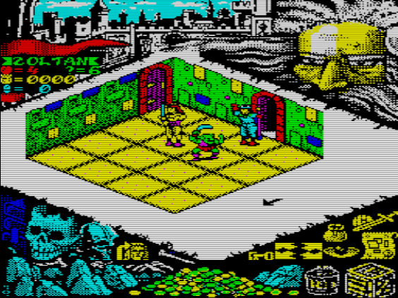
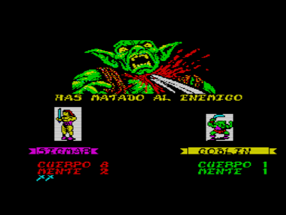

# HeroQuest for the Sinclair QL

[](README.en.md)
[](README.md)

A port of the video game **HeroQuest** (Gremlin Graphics, 1991; ZX Spectrum 128K version) to the **Sinclair QL**. Written in C89 (XTC68/`qcc`) with the critical parts in 68000 assembly, running in mode 8 (256×256, 8 colours). It includes the 14 missions of the base game, in Spanish and English, and can load the *Return of the Witch Lord* expansion.




## What it is and how it was made

It is not a Spectrum emulation: it is a rewrite based on an analysis of the original.

1. **Analysis of the original.** The Spectrum code was disassembled and commented (`ref/zx/`, `docs/ZX_*.md`): data structures, missions, graphics, sound and rules.
2. **Layered port.** Everything that depends on the hardware (screen, keyboard, mouse, sound, disk) lives in a platform layer (`src/plat_ql.c`, `src/plat_host.c`). The rest of the logic (game state, isometric view, turns, combat, spells, monsters, missions) is portable C, and a PC build exists to test it.
3. **Verification against the original.** The ported routines are compared with the Spectrum's own routines running in a Z80 simulator (the "oracles" in `tools/hq_oraculo_*.py`): tens of thousands of checks in `make test`. The QL tests are repeated in the sQLux emulator.
4. **Own data.** Graphics, texts and missions are extracted from the original tapes and repacked in QL format. The folders `asset/graficos_ql/`, `asset/textos_ql/` and `asset/misiones_ql/` hold the hand-retouched or translated versions, and the build prefers them over the originals.
5. **Assembly and improvements last.** First make it work and make it identical; then profile and move the slow parts to assembly.
6. **Bugs and secrets.** Several bugs and typos were fixed (especially in the Spanish version; for example, the elf is now told apart from the goblin), and a secret was found: the tune that plays on the language selection screen was hidden in the original Spectrum game!!
7. **Expansions.** The port is designed so that it is easy to create and load sets of missions. The system recognises them in the "Load other adventures" menu, so maybe in the future we will see The Keep of Kellar, The Mirror Mage and the rest of the adventures that came out for the board game.

Notes, findings and decisions are in `docs/` (start with `docs/PORT_QL.md`; the docs are in Spanish).

## Technical features

- **CPU and screen:** 68008 at 7.5 MHz, no FPU; mode 8 (256×256, 8 colours). The game switches to mode 8 on start and back to mode 4 on exit, without the "Press a key to exit" message.
- **Memory:** it needs about **370 KB** free at minimum (90 KB of code, 40 KB of job data and about 236 KB of heap for the graphics and the game). With plenty of RAM (about 435 KB) it preloads all missions and portraits; with less, it reads them from disk when needed. It works with 640 KB (tested). It does not fit with the Pointer Environment loaded in 640 KB.
- **Media:** 720 KB disk (`build/heroquest.img`) or a 4 MB QXL.WIN volume (`build/heroquest.win`).
- **Mice** (option 1 of the controls screen): cursor keys, **QIMSI** (enabled automatically if detected), **QIMI** and the **Pointer Environment** mouse. Only the keyboard option and the QIMSI in an emulator have been tested; the others are **untested on real hardware**.
- **Sound:** music and effects through the **QSound** card (AY-3-8912), detected automatically. Without it the game runs silent.
- **Languages:** Spanish and English, chosen on the first screen and switchable from the controls screen.
- **Drive and directory of the data:** the `boot` file is a SuperBASIC program that sets `DIR$ = "FLP1_"`, and every file (data, saved heroes) is loaded from there. To run the game from another drive or directory, edit `boot` and change that line, for example `DIR$ = "WIN1_HQ_"` or `DIR$ = "FLP2_"`. `data/boot` is plain text; write it back to the disk under that name (`qltools img -W boot`). Without `DIR$` the game uses the Toolkit II data directory, and otherwise `flp1_`.

## How to play

Boot from the disk (`LRUN flp1_boot`, or let the `boot` file start it). Choose a language and use the main menu: **Play**, **Buy equipment**, **Create character**, **Controls** and **Load other adventures** (for example `witchlord`).

- **Create character:** rename a hero, load and save it on disk, and activate or remove each hero (to play with fewer characters, or to revive the ones that died in a previous game).
- **Buy equipment:** weapons, armour and the toolbox, paid with the hero's gold.
- **Play:** pick a mission, read the objective and choose the spell groups (the wizard picks 3 groups when playing alone, or 1 when the elf plays too). Each hero rolls the dice, moves the cursor and clicks on squares and on the icons (next character, map, key, eye, attack and bag). Then Morcar's monsters play.
- **Keys:** `O`/`K` up/down, `Z`/`X` left/right, `SPACE` button; the cursor keys also work if the cursor-key option is on. `ESC` goes back (in a game it asks for confirmation before abandoning the mission).

## How to build

You need Linux (Debian was used), `make`, `gcc`, Python 3 and:

- **XTC68** (`qcc`, `as68`, `qld`) to build for the QL.
- **qltools** (disk image) and Norman Dunbar's **qxltool** (`.win` volume).
- **SkoolKit** in a virtual environment: `python3 -m venv tmp/venv && tmp/venv/bin/pip install skoolkit`.
- **sQLux** to try it (`make run`). See `docs/HERRAMIENTAS.md` for installing it and for the local patch for screenshots and keys.

### 1. Extract the data from the original tapes

The original TZX files are the source of everything; they must be in `ref/` with these names:

- `Hero Quest (Dro Soft).tzx` (Spanish version) and `Hero Quest - 128k.tzx` (English version).
- Optional, for the expansion: `Return Of The Witch Lord (Dro Soft).tzx` and `Return Of The Witch Lord - Side 1.tzx` / `Side 2.tzx`.

Then:

```sh
tmp/venv/bin/python -I tools/tzx_to_z80.py "ref/Hero Quest (Dro Soft).tzx" asset/extraido
tmp/venv/bin/python -I tools/tzx_to_z80.py "ref/Hero Quest - 128k.tzx" asset/extraido_en
tools/hq_ql_datos.sh extraer
```

The first line extracts the blocks and memory banks from the Spanish tape. The second does the same for the English one. The third extracts graphics, texts and missions into `asset/` and copies whatever is missing into the `*_ql` folders, never overwriting anything already retouched. The expansion's steps and options are in `docs/ZX_AMPLIACION.md` and `docs/ZX_VERSION_EN.md`.

### 2. Build

```sh
make data     # packs asset/ into data/ (runs by itself when something changes)
make ql       # build/heroquest, the QDOS executable
make img      # build/heroquest.img, a 720 KB disk with game, data and boot
make win      # build/heroquest.win, a 4 MB QXL.WIN volume
make run      # boot the image in sQLux
```

Plain `make` builds `img` and `win`. Other targets: `make host` (PC build with screenshots), `make test` (tests against the original) and `make c68_check` (check with 16-bit integers).

## License

GNU GPL v3 (see `LICENSE`). The original game, its graphics, texts and music belong to their authors; this project is a non-profit port.
